# TP - Pfense - Mathis Pahu (1)

## A. Mise en place d’un package sous pfSense :

<aside>
📌

**Contexte**

Vous venez d’installer pfSense pour la société LSL et avez accès au serveur web situé dans la DMZ.

Le DSI de l’entreprise souhaite désormais pouvoir consulter, depuis un navigateur, un maximum d’informations sur le réseau LAN.

</aside>

### **Qu’est-ce que pfSense :**

**PfSense** est un logiciel open source basé sur FreeBSD qui permet de sécuriser et gérer un réseau informatique. Il agit comme un pare-feu et un routeur, en filtrant le trafic réseau, en créant des connexions VPN sécurisées et en contrôlant les accès à Internet grâce à une interface web simple d'administration.

### <u>I) Installation d’une VM pfsense sur Proxmox :</u>

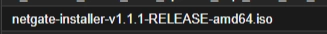

Après avoir téléversé l’image ISO, nous pouvons procéder à la création de la machine virtuelle, ce qui nous permettra ensuite d’installer **pfSense**.

Dès la création de la machine virtuelle terminée, nous devons ajouter trois interfaces réseau :

- **vmbr0** → **WAN**
- **lanMP** → **LAN**
- **dmzMP** → **DMZ**

Cette configuration permet à pfSense de gérer les communications entre le réseau externe (WAN), le réseau interne (LAN) et la zone démilitarisée (DMZ).

Après avoir installé et démarré la machine virtuelle, nous procédons aux étapes d’installation et de configuration :

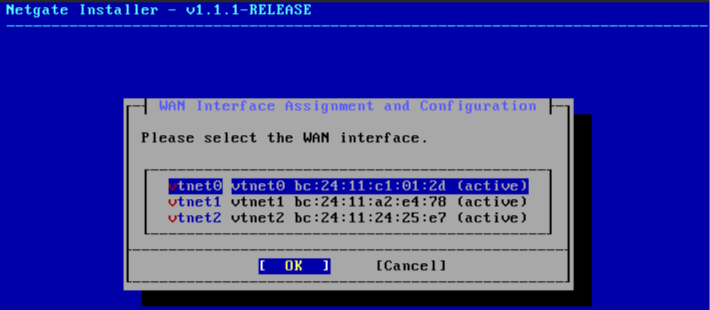

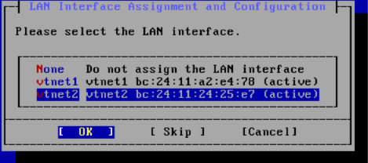

***Nous configurons l’interface WAN en l’associant à l’interface réseau vmbr0.***

***Puis nous configurons l’interface LAN de notre pfSense en l’associant à l’interface réseau  lanMP.***

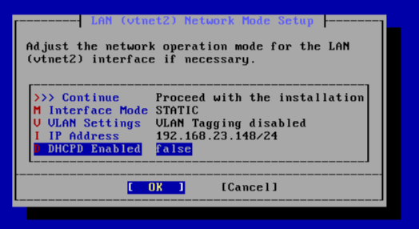

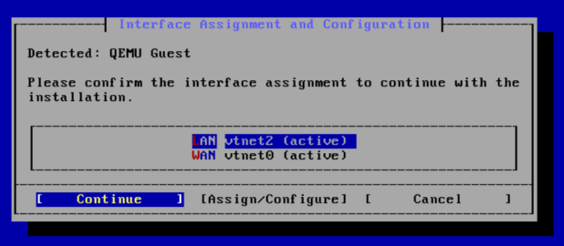

***Nous désactivons le service DHCP (True → False) afin d’éviter l’attribution automatique des adresses IP par pfSense. Nous configurons ensuite une adresse IP statique 192.168.23.148 pour l’interface WAN.***

Enfin, nous validons l’ensemble de nos configurations, puis nous lançons l’installation définitive de pfSense. Une fois l’installation terminée, nous arrivons à l’interface suivante :

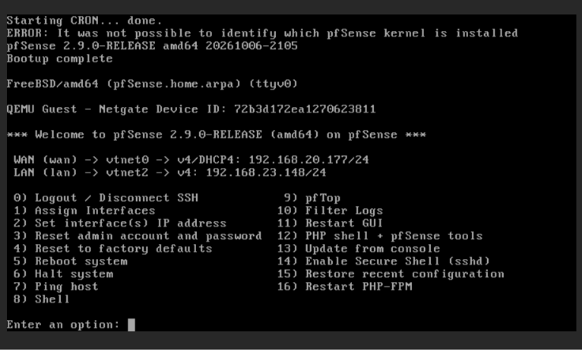

**Notre WAN est en 192.168.20.177***

### <u>II) Accès à l’interface Web de pfSense depuis un client Debian</u>

**Tout d’abord, nous affectons l’interface réseau lanMP à notre VM Debian**

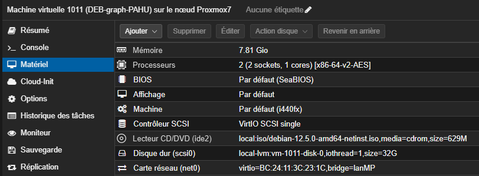

Depuis notre client Debian, nous configurons une adresse IP statique 192.168.23.149 et définissons comme passerelle par défaut l’adresse IP de notre pfSense, 192.168.23.148, afin de permettre la communication entre les deux machines.

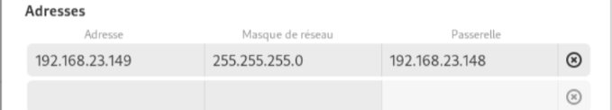

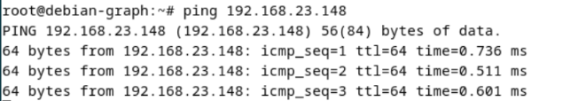

Le test de connectivité effectué à l’aide de la commande `ping` confirme que notre client Debian et pfSense communiquent correctement entre eux.

<u>***Voici la topologie actuelle :***</u>

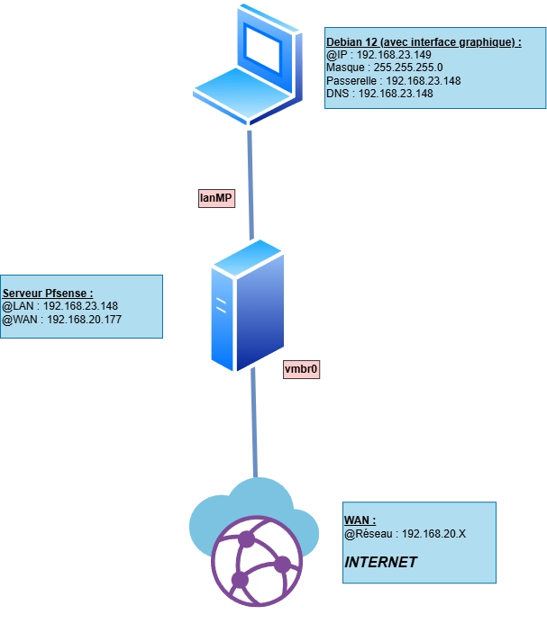

Depuis un navigateur Web sur notre client Debian, nous accédons à l’interface d’administration de pfSense en saisissant son adresse IP : 192.168.23.148.

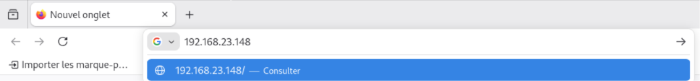

Nous nous connectons en entrant l’id → admin et le mot de passe → pfsense :

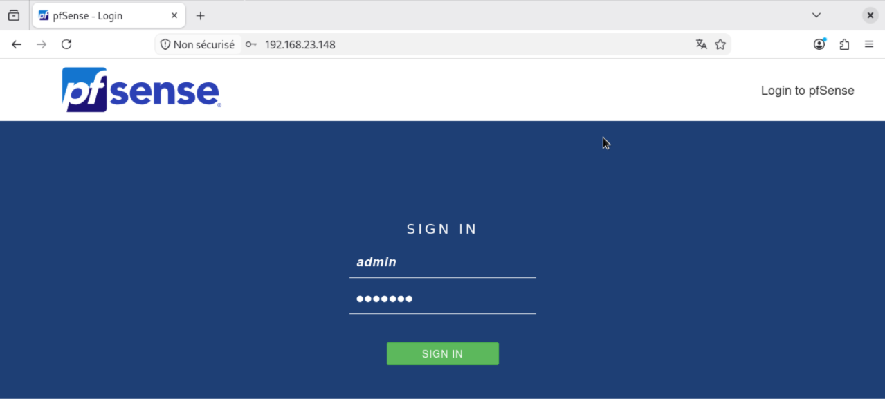

Pour affecter l’interface réseau dédiée à la DMZ, nous suivons le chemin suivant dans l’interface Web de pfSense : Accueil → Interfaces → Assignments → Add (+).

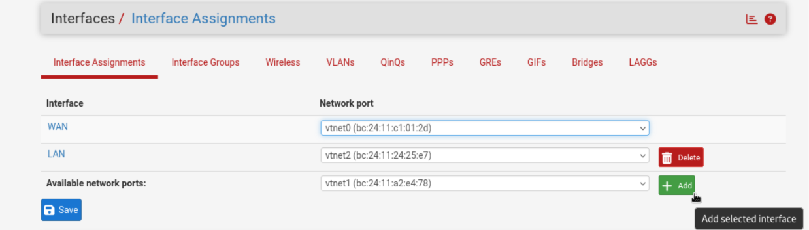

Nous sélectionnons ensuite l’interface OPT1 (vtnet1), puis nous la renommons dmzMP afin d’identifier clairement l’interface associée à notre zone démilitarisée (DMZ).

On affecte l’ip de la DMZ : 

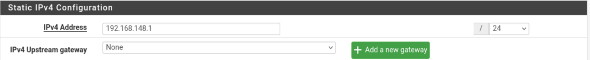

Puis nous retrouvons bien nos 3 interfaces : 

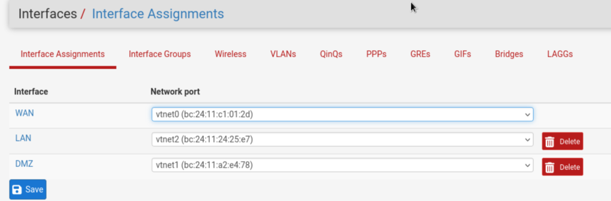

Processus pour créer une règle : 

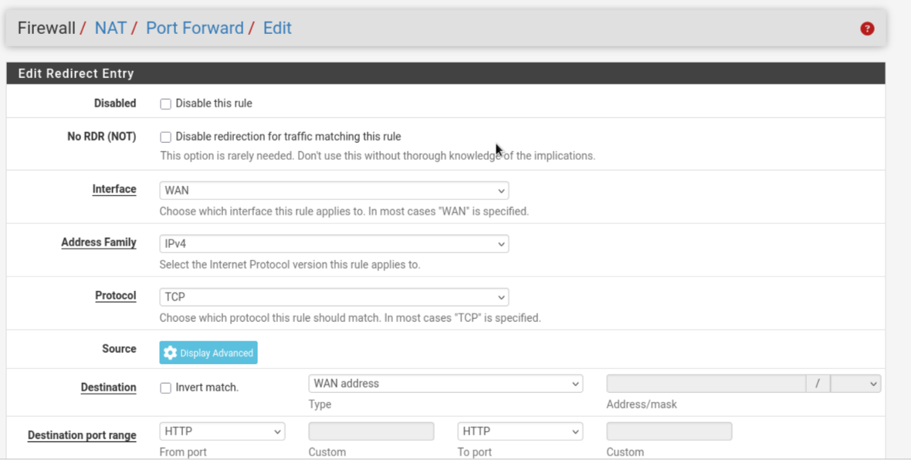

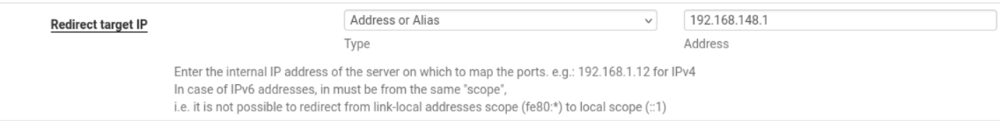

Nous configurons une règle NAT dans Firewall → NAT → Port Forward afin de rediriger les requêtes HTTP entrantes sur l’interface WAN de pfSense vers le serveur interne 192.168.148.1, via le protocole TCP et le port 80. 

**Cette règle permet de rendre le serveur Web accessible depuis le réseau externe, sans exposer directement l’ensemble du réseau interne.**

### <u>III) Test d’accès à l’interface Web d’un serveur LAMP hébergé dans la DMZ</u>

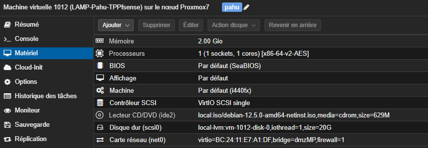

Nous configurons notre serveur LAMP pour qu’il soit sur la même interface réseau que notre DMZ → dmzMP.

Nous configurons notre serveur LAMP avec l’adresse IP statique 192.168.148.10, afin qu’il soit accessible sur le réseau de la DMZ et puisse recevoir les requêtes HTTP redirigées par pfSense.

Nous effectuons un test d’accès depuis le réseau WAN, à l’aide de l’adresse IP 192.168.20.177. Le test est concluant : l’interface Web de notre serveur LAMP, hébergé dans la DMZ, est accessible grâce à la règle de redirection NAT configurée sur pfSense.

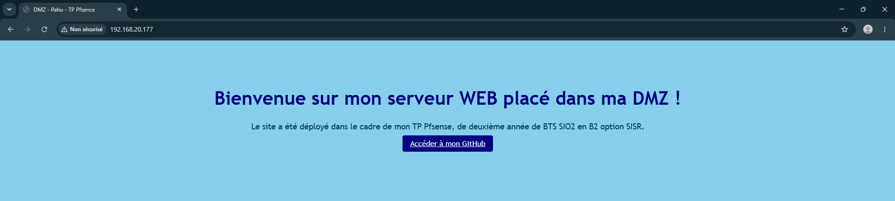

<u>***Topologie finale de la situation A :***</u>

.png)

## B. Mise en place d'un bureau distant sous pfSense :

<aside>
📌

**Contexte**

Le DSI souhaite maintenant installer un serveur Windows dans la DMZ
accessible en bureau à distance via le protocole RDP sur le port par défaut,et ce depuis internet .

Par mesure de sécurité vous utiliserez un port différent de votre choix
associé à l’adresse WAN du PFSense avec redirection du flux vers
l’adresse du serveur Windows associé au port par défaut .

</aside>

Nous configurons une règle de redirection NAT sur l’interface WAN de pfSense afin de rediriger le trafic TCP entrant sur le port **14823** vers notre serveur interne 192.168.148.11, sur le port RDP (3389). Cette règle permet d’accéder à distance au serveur via le protocole Bureau à distance (RDP)

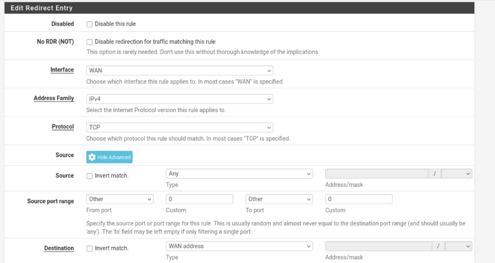

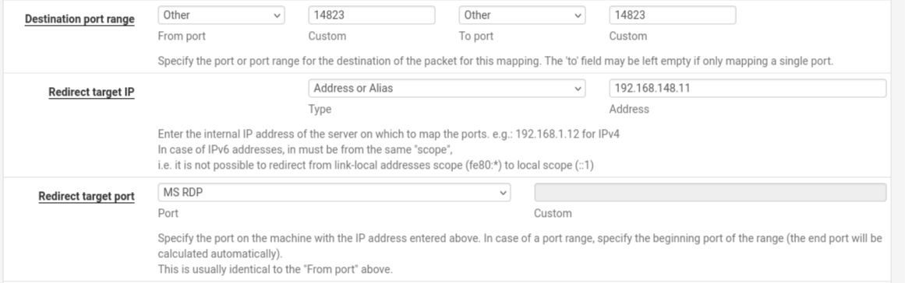

<u>**Récapitulatif des règles configurées :**</u>

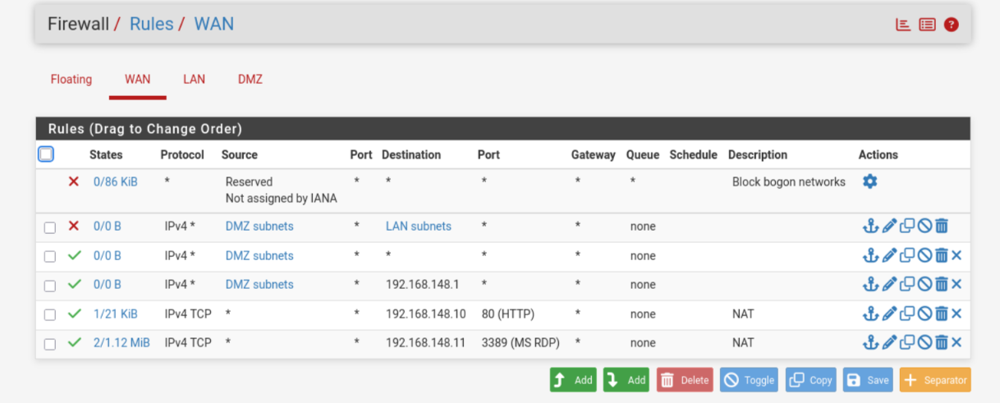

- Règle Block bogon networks : bloque les réseaux réservés ou non attribués sur Internet.
- Règle DMZ subnets : autorise le trafic provenant des sous-réseaux de la DMZ.
- Règle DMZ subnets : autorise également le trafic provenant des sous-réseaux de la DMZ selon les paramètres définis.
- Règle DMZ subnets : permet le trafic à destination de l’adresse IP `192.168.148.1`.
- Règle NAT HTTP : redirige les requêtes entrantes vers le serveur LAMP `192.168.148.10` sur le port `80` (HTTP).
- Règle NAT RDP : redirige les connexions entrantes sur le port externe `14823` vers le serveur `192.168.148.11` sur le port `3389` (RDP).

Nous configurons une adresse IP statique 192.168.148.11 sur notre Windows Server 2019, avec comme passerelle l’adresse IP de l’interface DMZ de pfSense. Depuis notre poste connecté au réseau WAN, nous établissons ensuite une connexion en Bureau à distance (RDP) via le port 14823. Le test est concluant : nous parvenons à accéder à notre serveur Windows à distance.

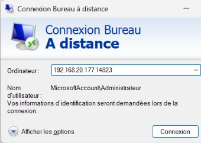

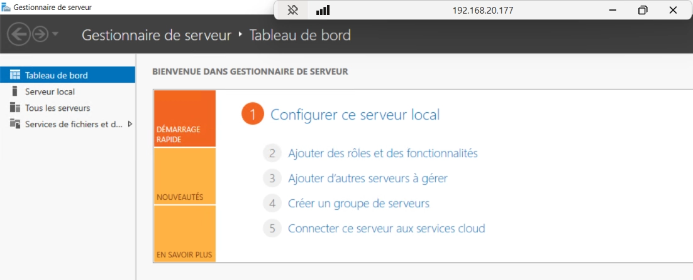